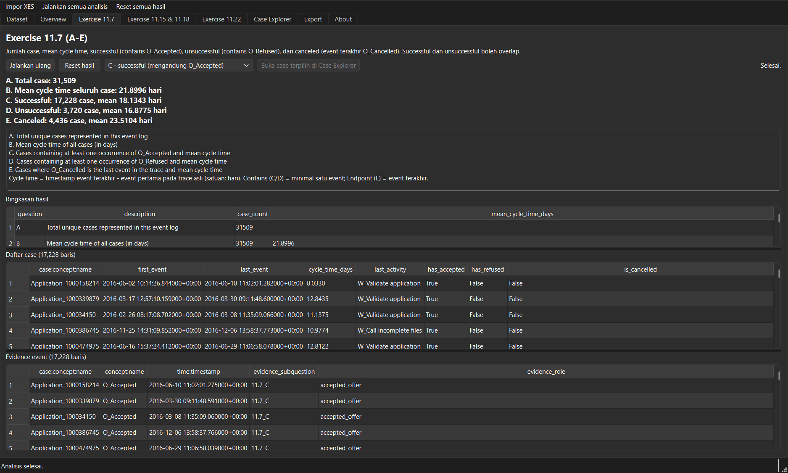

# BPIC17 Event Log Analyzer

Aplikasi desktop (Python, PM4Py, PySide6) untuk menjawab latihan Bab 11 *Fundamentals of Business Process Management* dari event log BPI Challenge 2017: Exercise 11.7 A-E, 11.15, 11.18, dan 11.22. Semua jawaban dihitung dari file XES yang dipilih pengguna dan dapat ditelusuri sampai ke event pembuktinya.



## Kebutuhan

| Komponen | Versi yang diuji |
| --- | --- |
| OS | Windows 11 |
| Python | 3.14.8 |
| PM4Py | 2.7.23.13 |
| pandas / numpy | 3.1.1 / 2.5.5 |
| PySide6 | 6.12.0 |
| RAM | 7,7 GB |
| Ruang disk | sekitar 1,2 GB untuk virtual environment |

Versi lengkap ada di `requirements.txt`. Versi yang sedang terpasang juga tampil di menu **About**. Versi Python lain belum diuji.

## Instalasi (PowerShell)

```powershell
git clone https://github.com/dianberlianhutasoit/bpic17-process-mining.git
cd bpic17-process-mining
python -m venv .venv
.\.venv\Scripts\python.exe -m pip install -r requirements.txt
```

Perintah di atas memanggil Python di `.venv` secara langsung, jadi environment tidak perlu diaktifkan.

## Dataset

Dataset tidak disertakan karena ukurannya besar.

1. Unduh **BPI Challenge 2017** dari [4TU.ResearchData](https://data.4tu.nl/articles/dataset/BPI_Challenge_2017/12696884).
2. Simpan filenya di folder `data/`. Format `.xes` dan `.xes.gz` bisa langsung dipakai, `.xes.gz` tidak perlu diekstrak.

File yang dipakai saat pengujian: `BPI Challenge 2017.xes.gz` (28,28 MB), MD5 `10b37a2f78e870d78406198403ff13d2`, berisi 31.509 case dan 1.202.267 event.

## Menjalankan aplikasi

```powershell
.\.venv\Scripts\python.exe main.py
```

| Langkah | Cara |
| --- | --- |
| 1. Impor XES | Klik **Impor XES...** (Ctrl+O), pilih file. Untuk BPIC17 penuh butuh sekitar 1,5-4 menit |
| 2. Lihat ringkasan | Tab **Dataset** (file, atribut, peringatan) dan **Overview** (metrik, aktivitas, durasi per case) |
| 3. Jalankan analisis | **Jalankan semua analisis** (Ctrl+R), atau tombol jalankan di tab latihan masing-masing |
| 4. Baca jawaban | Tab **Exercise 11.7**, **Exercise 11.15 & 11.18**, **Exercise 11.22**: jawaban, aturan filter, daftar case, dan evidence |
| 5. Periksa case | Klik dua kali sebuah case, atau **Buka case terpilih di Case Explorer** |
| 6. Ekspor | Tab **Export** |
| 7. Ulangi | **Reset hasil** (satu latihan) atau **Reset semua hasil**, lalu jalankan lagi tanpa impor ulang |

Di **Case Explorer**, pilih *Sumber daftar* (semua case, 11.7 C/D/E, 11.15, 11.18, atau 11.22), cari Case ID, lalu pilih case untuk melihat urutan event, lifecycle, dan resource-nya.

## Ekspor CSV

| Tombol | File yang dibuat |
| --- | --- |
| Ekspor ringkasan semua hasil | Satu CSV: aturan filter, jumlah case, mean cycle time atau persentase, dan denominator |
| Ekspor daftar case + evidence | Tiga CSV: `<nama>.csv` (daftar case), `<nama>_evidence.csv`, dan `<nama>_ringkasan.csv` |

CSV memakai pemisah koma, desimal titik, dan UTF-8. Di Excel berbahasa Indonesia, jangan buka dengan klik dua kali. Gunakan **Data > From Text/CSV**, pilih *File Origin* UTF-8 dan *Delimiter* koma. Jika angka desimal terbaca salah, klik **Transform Data**, lalu pada kolom itu pilih **Change Type > Using Locale > Decimal Number, English (United States)**.

## Definisi yang dipakai

| Istilah | Aturan |
| --- | --- |
| Cycle time | Event terakhir - event pertama pada trace asli, dalam hari. Filter memilih case, tidak membuang event |
| 11.7 C / D | Case memuat minimal satu `O_Accepted` / `O_Refused`; boleh beririsan |
| 11.7 E | Event terakhir pada trace adalah `O_Cancelled` |
| 11.15 | Minimal dua event `W_Assess potential fraud` dengan `lifecycle:transition = complete` |
| 11.18 | Seperti 11.15, dan minimal dua di antaranya oleh resource yang sama; resource kosong tidak dihitung |
| 11.22 | `O_Cancelled` diikuti `O_Accepted` pada posisi lebih akhir, tidak harus bersebelahan; denominator seluruh case |
| Urutan event | Menurut waktu (UTC); bila sama, mengikuti urutan di file XES |

## Hasil pada BPIC17

| Soal | Hasil aplikasi | Buku |
| --- | --- | --- |
| 11.7 A | 31.509 case | 31.509 |
| 11.7 B | 21,8996 hari | 21,9 |
| 11.7 C | 17.228 case; 18,1343 hari | 17.228; 18,1 |
| 11.7 D | 3.720 case; 16,8775 hari | 3.720; 16,8 |
| 11.7 E | 4.436 case; 23,5104 hari | 4.436; 23 |
| 11.15 | 13 case | 13 (Celonis) |
| 11.18 | 3 case | 3 (Celonis) |
| 11.22 | 902 dari 31.509 case = 2,8627% | tidak ada jawaban |

Penjelasan selisih D dan E ada di [docs/test_report.md](docs/test_report.md).

## Keterbatasan

- Impor BPIC17 memakai memori hingga sekitar 4,3 GB, dan jendela bisa tersendat 2-16 detik. Tutup aplikasi lain, tunggu sampai status selesai, dan hindari impor ulang bila tidak perlu.
- Atribut wajib: `case:concept:name`, `concept:name`, `time:timestamp`. Tanpa `lifecycle:transition`, 11.15 dan 11.18 tidak dapat dihitung; tanpa `org:resource`, 11.18 tidak dapat dihitung.
- 11.22 dihitung pada level case, bukan level offer.
- Kolom posisi pada hasil 11.22 dimulai dari 0, sedangkan kolom `no` di Case Explorer dimulai dari 1.
- Process discovery (Alpha, Heuristics, Inductive Miner) tidak termasuk cakupan.

## Pengujian

```powershell
.\.venv\Scripts\python.exe -m pip install pytest
.\.venv\Scripts\python.exe -m pytest -v
```

Hasil terakhir: 169 passed, 1 skipped, 1 xfailed. Test yang dilewati memakai dataset penuh; `xfailed` menandai bug kecil yang sudah diketahui. Rinciannya di [docs/test_report.md](docs/test_report.md).

## Struktur folder

```text
├── main.py                     titik masuk aplikasi
├── requirements.txt
├── data/                       dataset lokal, tidak masuk Git
├── src/
│   ├── data_loader.py          impor dan validasi XES
│   ├── overview.py             statistik dasar
│   ├── analysis_117.py         Exercise 11.7 A-E
│   ├── advanced_analysis.py    Exercise 11.15, 11.18, 11.22
│   ├── main_window.py          jendela utama
│   ├── analysis_panel.py       panel hasil latihan
│   ├── case_explorer.py        daftar case dan trace
│   ├── exporter.py             ekspor CSV
│   ├── workers.py              proses latar belakang
│   ├── table_model.py          tabel GUI
│   ├── constants.py            nama kolom dan aktivitas
│   └── run_*.py                menjalankan analisis tanpa GUI
├── tests/                      test unit, GUI, dan integrasi
└── docs/
    ├── laporan.md              laporan proyek
    ├── test_report.md          laporan pengujian
    ├── demo_flow.md            alur demo
    ├── advanced_analysis_rules.md
    ├── loader_and_overview_report.md
    └── screenshots/
```
