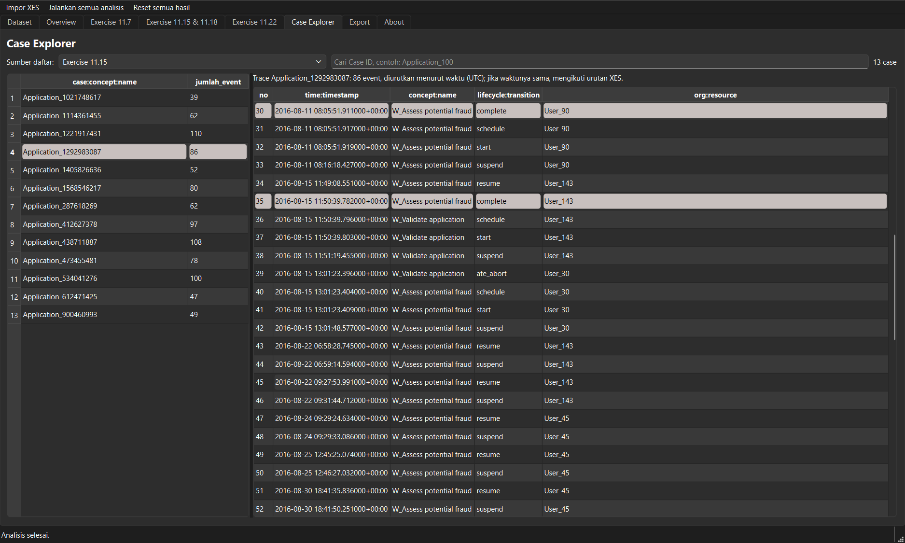
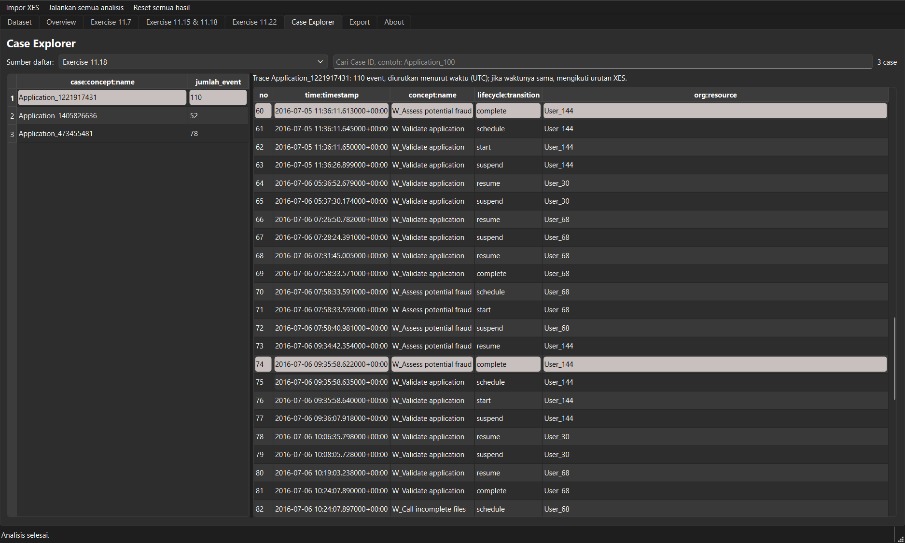
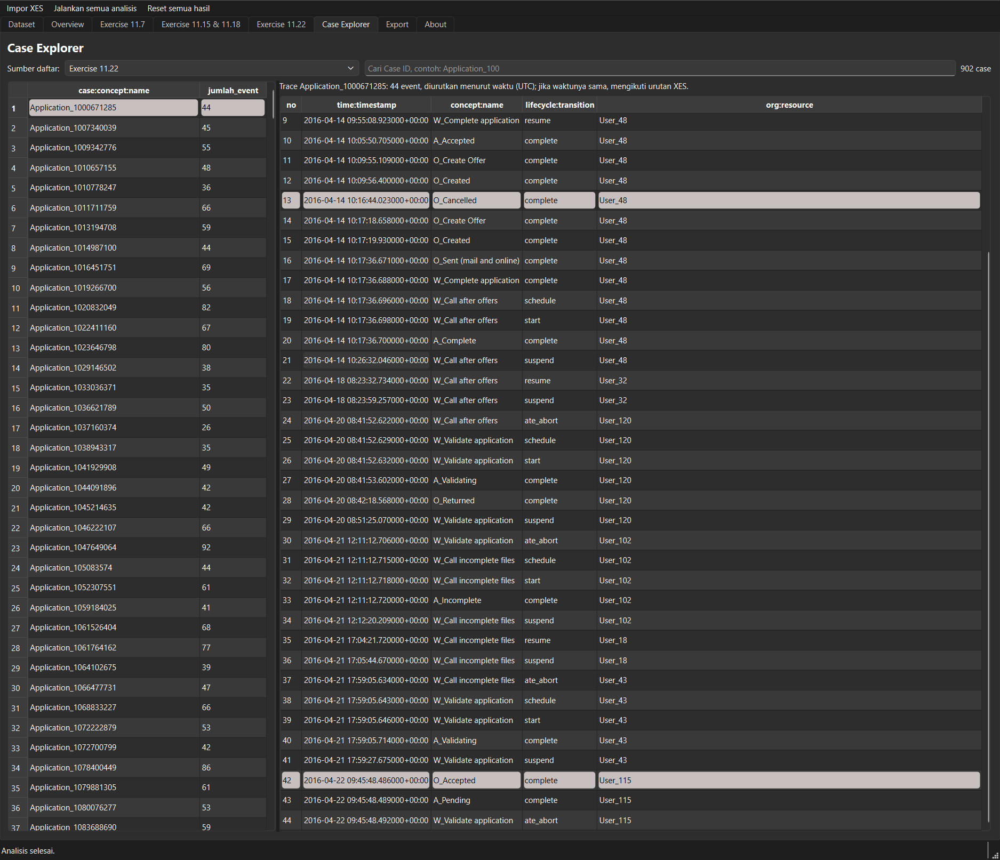

# Laporan Proyek Tahap 1: Aplikasi Desktop Analisis Event Log BPIC17

| | |
| --- | --- |
| Mata kuliah / kelas | Penambangan Data/ A |
| Dosen | Dr. Indra Waspada, S.T., M.TI |
| Anggota (nama lengkap, NIM) | Shakila Tungga Dewi;Gregorius Septiano Ariadi; dian berlian hutasoit; Husein Avicenna; Shofi Rasyida Nata |
| Repositori | https://github.com/dianberlianhutasoit/bpic17-process-mining |
| Tanggal | 25 November 2026 |

## 1. Ringkasan

Aplikasi membaca file XES pilihan pengguna dengan PM4Py, lalu menjawab Exercise 11.7 A-E, 11.15, 11.18, dan 11.22. Setiap jawaban disertai aturan filter, daftar case, dan event pembukti yang dapat dibuka di Case Explorer dan diekspor ke CSV. Pada BPIC17, semua jumlah case yang punya pembanding sama dengan buku. Mean cycle time B dan C sama setelah dibulatkan, sedangkan D dan E sedikit berbeda (bagian 4.1).

Dataset: BPI Challenge 2017, [4TU.ResearchData](https://data.4tu.nl/articles/dataset/BPI_Challenge_2017/12696884), file `BPI Challenge 2017.xes.gz`, MD5 `10b37a2f78e870d78406198403ff13d2`. Isinya 31.509 case, 1.202.267 event, 26 aktivitas, 149 resource, periode 1 Januari 2016 - 1 Februari 2017 (UTC).

Lingkungan: Windows 11, Python 3.14.8, PM4Py 2.7.23.13, pandas 3.1.1, PySide6 6.12.0.

## 2. Pemetaan soal ke fungsi aplikasi

| Soal | Pertanyaan | Fungsi | Menu |
| --- | --- | --- | --- |
| 11.7 A | Jumlah case | `analysis_117.analyze_117` | Exercise 11.7 |
| 11.7 B | Mean cycle time seluruh case | `analysis_117.analyze_117` | Exercise 11.7 |
| 11.7 C | Successful cases dan mean-nya | `analysis_117.analyze_117` | Exercise 11.7 |
| 11.7 D | Unsuccessful cases dan mean-nya | `analysis_117.analyze_117` | Exercise 11.7 |
| 11.7 E | Canceled cases dan mean-nya | `analysis_117.analyze_117` | Exercise 11.7 |
| 11.15 | Fraud assessment complete minimal 2x | `advanced_analysis.analyze_11_15` | Exercise 11.15 & 11.18 |
| 11.18 | Seperti 11.15, resource sama | `advanced_analysis.analyze_11_18` | Exercise 11.15 & 11.18 |
| 11.22 | `O_Cancelled` lalu `O_Accepted`, persentase | `advanced_analysis.analyze_11_22` | Exercise 11.22 |

| Fitur wajib | Modul | Menu |
| --- | --- | --- |
| F01 Impor dan validasi XES | `data_loader.py`, `workers.py` | Dataset |
| F02 Overview | `overview.py` | Overview |
| F03 Exercise 11.7 | `analysis_117.py`, `analysis_panel.py` | Exercise 11.7 |
| F04 Repeated complete | `advanced_analysis.py`, `analysis_panel.py` | 11.15 |
| F05 Same resource | `advanced_analysis.py`, `analysis_panel.py` | 11.18 |
| F06 Eventually follows | `advanced_analysis.py`, `analysis_panel.py` | 11.22 |
| F07 Case Explorer, ekspor, reset | `case_explorer.py`, `exporter.py`, `main_window.py` | Case Explorer, Export |

File hanya dibaca sekali. Semua modul analisis memakai data yang sama dan mengembalikan format yang sama: `metadata`, `summary`, `case_ids`, `evidence`, `per_case`.

## 3. Definisi filter

| Istilah | Aturan |
| --- | --- |
| Case | Satu `case:concept:name`; dihitung satu kali walaupun event pemicu muncul berkali-kali |
| Cycle time | Timestamp event terakhir - event pertama pada trace asli, dalam hari. Filter memilih case tanpa membuang event |
| 11.7 C (contains) | Minimal satu `O_Accepted` |
| 11.7 D (contains) | Minimal satu `O_Refused` |
| 11.7 E (endpoint) | Event terakhir adalah `O_Cancelled`. `O_Cancelled` di tengah trace tidak dihitung |
| 11.15 | Minimal dua event `W_Assess potential fraud` dengan `lifecycle:transition = complete`. Transisi lain (`schedule`, `start`, `suspend`, `resume`, `withdraw`, `ate_abort`) tidak dihitung |
| 11.18 | Minimal dua event `complete` pada 11.15 oleh `org:resource` yang sama. Resource kosong dikeluarkan, tidak dianggap resource yang sama |
| 11.22 | Ada posisi i < j dengan event i = `O_Cancelled` dan event j = `O_Accepted`, tidak harus bersebelahan. Denominator = seluruh case pada log aktif |
| Urutan event | Menurut waktu (UTC); bila sama, mengikuti urutan di file XES |

Di materi tertulis `W_Assess Potential Fraud`, sedangkan di file XES `W_Assess potential fraud`. Pencocokan nama aktivitas ini tidak membedakan huruf besar dan kecil.

## 4. Hasil BPIC17

| Soal | Hasil aplikasi | Buku | Keterangan |
| --- | --- | --- | --- |
| 11.7 A | 31.509 case | 31.509 | Sama |
| 11.7 B | 21,8996 hari | 21,9 | Sama setelah dibulatkan |
| 11.7 C | 17.228 case; 18,1343 hari | 17.228; 18,1 | Sama setelah dibulatkan |
| 11.7 D | 3.720 case; 16,8775 hari | 3.720; 16,8 | Jumlah sama; mean berbeda (4.1) |
| 11.7 E | 4.436 case; 23,5104 hari | 4.436; 23 | Jumlah sama; mean berbeda (4.1) |
| 11.15 | 13 case, 27 event complete | 13 (Celonis); 20 (Disco) | Sama dengan Celonis |
| 11.18 | 3 case | 3 (Celonis); 8 (Disco) | Sama dengan Celonis |
| 11.22 | 902 / 31.509 = 2,8627% | tidak ada | Ya, terjadi |

Menurut buku, Disco 2.0 menghasilkan angka lebih besar karena juga menghitung tugas yang dijadwalkan atau dimulai tetapi tidak selesai. Pada data ini ada 303 case dengan minimal dua event `W_Assess potential fraud` bila lifecycle diabaikan, tetapi hanya 13 bila dibatasi pada `complete`.

### 4.1 Selisih mean 11.7 D dan E

Sembilan definisi cycle time dicoba ([test_report.md](test_report.md) bagian 4). Tidak ada yang cocok dengan semua angka buku. Definisi yang dipakai aplikasi cocok untuk semua jumlah case serta mean B dan C, dan sesuai instruksi proyek. Penyebab selisih tidak dapat dipastikan dari materi; kemungkinan angka buku dipotong (16,8775 menjadi 16,8 dan 23,5104 menjadi 23). Hasil aplikasi tidak disesuaikan dengan buku.

### 4.2 Temuan

1. **Hampir semua canceled case pada 11.7 E juga successful.** Dari 4.436 case, 4.435 memuat `O_Accepted` dan tidak satu pun memuat `A_Cancelled`. Pada 4.435 case itu, `O_Cancelled` terakhir selalu milik offer lain (OfferID berbeda dari yang diterima), dan 4.432 di antaranya terjadi paling lama 1 detik setelah `O_Accepted`. Jadi 11.7 E, menurut definisi soal, sebagian besar berisi pengajuan yang berhasil dengan offer lain yang ditutup. Kelompok C dan E karena itu beririsan dan jumlahnya tidak boleh dijumlahkan.
2. **Pengajuan yang dibatalkan umumnya tidak berakhir dengan `O_Cancelled`.** Ada 10.431 case yang memuat `A_Cancelled`; tidak satu pun masuk 11.7 E, dan sebagian besar (8.234) berakhir dengan `W_Call after offers` berstatus `ate_abort`.
3. **11.7 D tidak beririsan dengan C maupun E** pada data ini, walaupun aturan memperbolehkan irisan.
4. **Pada 11.22, offer yang dibatalkan dan yang diterima berbeda.** Pada ke-902 pasangan event pembukti, OfferID keduanya tidak ada yang sama. Ini analisis tambahan; jawaban soal tetap dihitung pada level case.

## 5. Contoh bukti case

Baris bukti pada gambar trace disorot khusus untuk laporan. Di aplikasi, satu baris dapat dipilih pada satu waktu.

### 11.15: `Application_1292983087`

Tiga event complete, oleh tiga resource berbeda, sehingga lolos 11.15 tetapi tidak 11.18.

| No | Waktu (UTC) | Aktivitas | Lifecycle | Resource |
| --- | --- | --- | --- | --- |
| 30 | 2016-08-11 08:05:51 | W_Assess potential fraud | complete | User_90 |
| 35 | 2016-08-15 11:50:39 | W_Assess potential fraud | complete | User_143 |
| 86 | 2016-10-07 07:04:40 | W_Assess potential fraud | complete | User_138 |

### 11.18: `Application_1221917431`

Dua event complete oleh resource yang sama.

| No | Waktu (UTC) | Aktivitas | Lifecycle | Resource |
| --- | --- | --- | --- | --- |
| 60 | 2016-07-05 11:36:11 | W_Assess potential fraud | complete | User_144 |
| 74 | 2016-07-06 09:35:58 | W_Assess potential fraud | complete | User_144 |

Case lainnya: `Application_1405826636` dan `Application_473455481`, keduanya oleh User_143.

### 11.22: `Application_1000671285`

`O_Cancelled` diikuti `O_Accepted`, dengan 28 event di antaranya.

| No | Waktu (UTC) | Aktivitas | Lifecycle | Resource |
| --- | --- | --- | --- | --- |
| 13 | 2016-04-14 10:16:44 | O_Cancelled | complete | User_48 |
| 42 | 2016-04-22 09:45:48 | O_Accepted | complete | User_115 |

## 6. Pengujian

| Pengujian | Hasil |
| --- | --- |
| Seluruh test otomatis | 169 passed, 1 skipped, 1 xfailed |
| Test loader dengan dataset penuh | 24 passed |
| 12 skenario wajib lewat GUI (log sintetis) | 12 sesuai |
| Kerusakan kode buatan (mutation check) | 12 dari 12 tertangkap |
| BPIC17 penuh lewat GUI | Jawaban sama setelah reset dan setelah impor ulang |
| Instalasi di virtual environment baru, komputer yang sama | Berhasil; `main.py` terbuka dan seluruh test lulus |

Rincian skenario, expected dan actual, serta daftar bug ada di [test_report.md](test_report.md).

Belum diuji: pemasangan di komputer lain dan Excel berlokal Indonesia. **[konfirmasi sebelum dikumpulkan]**

## 7. Kendala

| Kendala | Penanganan |
| --- | --- |
| Impor BPIC17 1,5-4 menit, GUI dapat tersendat 2-16 detik (BUG-04) | Impor di worker thread dengan progress; penyebab pasti belum ditemukan. **[perbarui bila sudah diperbaiki]** |
| Status dapat menulis analisis gagal dua kali (BUG-08) | Terbuka, dampak rendah. **[perbarui bila sudah diperbaiki]** |
| Mean 11.7 D dan E berbeda dari buku | Dijelaskan di 4.1 |
| `11.15` di CSV berisiko terbaca sebagai jam di Excel | Label ditulis `Exercise 11.15` |
| Penulisan nama aktivitas fraud berbeda antara materi dan XES | Pencocokan tidak membedakan huruf besar dan kecil |

## 8. Kontribusi anggota

Disusun dari panduan pembagian tugas dan riwayat Git. **[konfirmasi tiap anggota]**

| Anggota | Kontribusi |
| --- | --- |
| Dian | Koordinasi, kerangka proyek, Exercise 11.7 (`analysis_117.py`), integrasi modul analisis dan test-nya |
| Husein | Impor dan validasi XES (`data_loader.py`), Overview (`overview.py`), test loader, dokumentasi atribut |
| Tio | Exercise 11.15, 11.18, 11.22 (`advanced_analysis.py`), test, dan dokumentasi aturan |
| Nata | Jendela utama, panel analisis, worker (`main_window.py`, `analysis_panel.py`, `workers.py`, `table_model.py`), `main.py`, smoke test |
| Shakila | Case Explorer (`case_explorer.py`), ekspor CSV (`exporter.py`), test integrasi, laporan pengujian, README, draf laporan, screenshot |

Catatan: instruksi proyek menyebut 4 mahasiswa, sedangkan kelompok ini 5 orang. **[konfirmasi ke dosen]**

## 9. Screenshot menu

| Menu | Gambar |
| --- | --- |
| Dataset | [01_dataset.png](screenshots/01_dataset.png) |
| Overview | [02_overview.png](screenshots/02_overview.png) |
| Exercise 11.7 | [03_exercise_11_7.png](screenshots/03_exercise_11_7.png) |
| Exercise 11.15 | [04_exercise_11_15.png](screenshots/04_exercise_11_15.png) |
| Exercise 11.18 | [05_exercise_11_18.png](screenshots/05_exercise_11_18.png) |
| Exercise 11.22 | [06_exercise_11_22.png](screenshots/06_exercise_11_22.png) |
| Case Explorer | [07_case_explorer_daftar_11_7_e.png](screenshots/07_case_explorer_daftar_11_7_e.png) |
| Trace 11.15, 11.18, 11.22 | Bagian 5 |
| Export | [11_export.png](screenshots/11_export.png) |
| About | [12_about.png](screenshots/12_about.png) |
